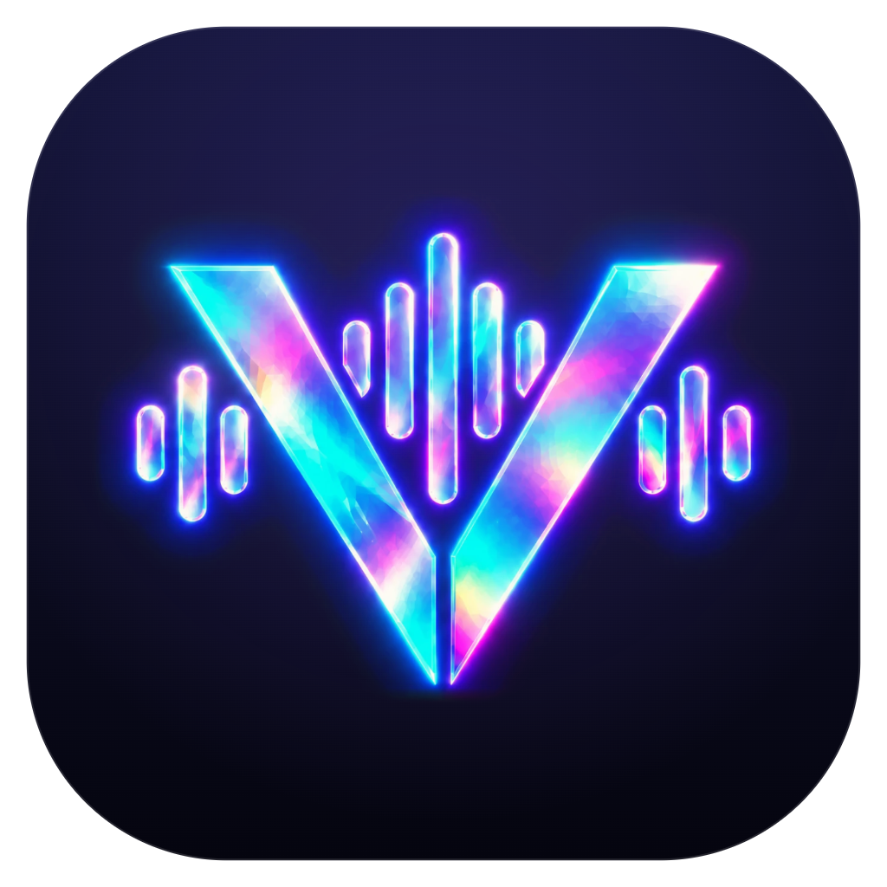

# Vyse Music



Vyse Music used to be called Encore. Updating keeps everything you had.

A free, ad-free desktop music player for Windows. Search the whole YouTube Music catalog, play anything, connect Spotify, YouTube Music or Apple Music to keep your playlists here and up to date, bring in your history, and play the music files on your computer. Everything stays on your own machine. No server, no tracking, and no account needed.

## Download

**[Download Vyse Music for Windows](https://github.com/Sameer786op/encore/releases/latest)** and open `Vyse-Music-Setup-<version>.exe` from the list of files. It installs in a few seconds, needs no admin rights, opens straight away, and adds Vyse Music to the Start menu and the desktop.

The first time, Windows may say "Windows protected your PC", because Vyse Music isn't signed with a paid certificate. Click **More info**, then **Run anyway**.

Vyse Music keeps itself up to date: it checks every time you open it and every hour after, new versions download in the background, and they go in the next time it starts. **Settings → About** shows your version and can check right away. To remove it, use **Settings → Apps** in Windows; your library stays in `%APPDATA%\Vyse Music` (or `%APPDATA%\Encore` if you had it before the rename) in case you come back.

## What works today

- **Search** songs, albums, artists, videos and playlists, with tabs for each. As you type, suggestions show searches and songs, artists, albums and playlists you can open right away. A misspelling gets **Did you mean…** (or is corrected for you), and when nothing holds the words you typed, **related searches** come first; when there are no results at all, they're offered instead. A song that's only an upload is found among the videos and moved up with the songs. **Show more** keeps going past the first page. A search is asked again after 10 minutes so new uploads turn up, and **Refresh** asks right away.
- **Playback** that starts in about a second, with seeking anywhere in the song. Songs stream in the best format YouTube Music offers without Premium: Opus at about 130–160 kbps and 48 kHz. The sound panel shows the format of the song that's playing. Volume, shuffle, repeat (all / one), and a song that won't load is skipped with a message.
- **Queue**: play now, play next, add to queue, drag to reorder, remove, clear. When the queue runs out, **Autoplay** keeps going with similar songs. **Start radio** works from any song.
- **Library**: liked songs, playlists (create, rename, delete, add, remove, drag to reorder), and recently played (a song counts after 30 seconds).
- **Album and artist pages**, plus a home page built from your own listening (see Phase 4) followed by what's new on YouTube Music: new releases, trending songs, new music videos, and charts and playlists you can open, play or save. It refreshes every 10 minutes while it's on screen, and **Check for new songs** at the top asks YouTube Music right away and looks for new releases from your artists. Artist pages are fetched again after 10 minutes, so a new single shows up without a restart. Songs never have to be added by hand: everything comes straight from YouTube Music when you look.
- **Windows integration**: media keys and the Windows media overlay, native window buttons with snap layouts, and a taskbar icon.
- **It remembers**: the queue, the current song and its position, and the volume all survive a restart. If music was playing when you closed it, it carries on from the same spot when you open it again (Settings → Playback → Continue where you left off).

### Bring your music in (Phase 2)

Your music comes in four ways:

- **Connected accounts** (Settings, Connected accounts): connect Spotify, YouTube Music or Apple Music and every playlist you have there shows up in Vyse Music, kept up to date. Songs you add or remove there change here too, on opening Vyse Music and every 15 minutes while it's open (or straight away with Sync now). Liked songs come over as their own playlist, like *Liked on Spotify*, and the artists you follow there are followed here, so their new releases show up. Any playlist can be switched off. Synced playlists change only where they come from; *Make a copy* gives you one of your own to change. You sign in to Spotify and Apple Music on their own page in a window from Vyse Music, so your password goes only to them. YouTube Music signs in with the Google account already in your browser: Vyse Music shows a code, you enter it on Google's page (google.com/device), pick your account and click Allow, with nothing to type. Nothing is ever changed on your account. Songs still play free from YouTube Music, with no Premium needed. Nothing changes until you connect an account.
  - These services don't officially offer this to apps like Vyse Music (Spotify's official route needs Premium since 2026), so Vyse Music reads with the same sign-in their own web players use. A change on their side can stop a connection working until Vyse Music is updated. Spotify only lists the songs of playlists you made or collaborate on; for playlists you follow, the first 100 songs come over.
- **Playlist and album links** from Spotify (up to 100 songs, all Spotify shares without an account), Apple Music and YouTube / YouTube Music (whole playlists, exact songs).
- **Your data exports**, which every service gives you for free:
  - Spotify, from *spotify.com/account/privacy*: the full streaming history (extended or last year), your liked songs and all your playlists.
  - Google Takeout, from *takeout.google.com*: YouTube Music history (JSON or the default HTML) and playlists.
  - Apple, from *privacy.apple.com*: daily play history or play activity, loved songs, your library and playlists. The zips inside the zip are read for you.
  - CSV files from Exportify, TuneMyMusic, Soundiiz and similar tools, which also covers services Vyse Music can't read directly, like SoundCloud.
- **Music files on your computer**: MP3, FLAC, AAC/M4A, Ogg, Opus and WAV, with their tags and cover art. Folders are watched, so new files appear on their own.

Songs from Spotify, Apple Music and CSVs are matched to YouTube Music by title, artists and length. Live versions, remixes, sped-up edits and radio edits count as different songs. Confident matches go straight through; doubtful ones wait on a **review screen** where you can accept, pick another version, search for the right one, or leave a song out. Nothing is added until you press the button. Matches are remembered, so importing the same songs again is instant.

Imported history is saved straight away and powers **Your listening**: total plays and time, plays by year, your top songs and artists across every service and Vyse Music itself, and a one-click playlist of your top 50.

### Look and sound (Phase 3)

- **Full-screen player** (click the cover, or press F): a moving background painted from the cover's colours that breathes with the bass, a large cover that springs forward when the music plays and sits back when you pause, and all the controls.
- **Synced lyrics** (press L): lines light up word by word as they're sung, the view follows the song, long instrumental breaks show animated dots, and clicking a line jumps there. Per-song timing can be nudged if lyrics run early or late. Lyrics come from LRCLIB, a free and open lyrics library, with YouTube Music's plain lyrics as a fallback. Local files use a matching `.lrc` file or lyrics inside their tags.
- **Equalizer**: 10 bands, a preamp and 11 presets, with a live response curve. A limiter keeps boosts from clipping.
- **Crossfade** from 1 to 12 seconds, or **gapless** playback when it's off: the next song is buffered ahead of time and starts the moment the last one ends. Albums play through without fading unless you ask.
- **Volume levelling**: every song plays at about the same loudness, using YouTube's loudness data or ReplayGain tags in your files.
- **Mini player**: a small always-on-top window with the cover, controls and progress. Drag it anywhere; it remembers where. It can open on its own when you minimise Vyse Music.
- **Discord status**: "Listening to" with the song, artist, cover, a progress bar and a "Listen on YouTube Music" button. Discord needs an application for this: create one called "Vyse Music" at [discord.com/developers/applications](https://discord.com/developers/applications), copy its Application ID into Settings → Discord, and switch it on.

### Your feed (Phase 4)

- **A home page made from your history**: your daily mixes, new releases from your artists, songs you have on repeat, your top artists, and forgotten favourites you used to play a lot. It uses everything you've listened to: imported history from Spotify, YouTube Music and Apple Music, plus what you play in Vyse Music, with recent listening counting most and liked songs counting extra.
- **Daily mixes**: your top artists are grouped by who sounds alike (using YouTube Music's "Fans might also like"), and each mix weaves your favourites from them with their popular songs and new discoveries, never the same artist twice in a row. They're remade every day and stay the same all day; **Save** keeps one as a playlist.
- **Mood mixes**: pick a mood on Home (Chill, Energize, Focus, Warm, Feel good, Party, Workout, Sad or Sleep) and press **Start mix**. The mix weaves your own top songs that suit the mood, going by the moods YouTube Music tags each song with, with YouTube Music's radio tuned to that mood and started from your songs. It plays right away and opens as a page with **New mix** for a different one and **Save** to keep it. Before you've played anything, it uses YouTube Music's own playlists for the mood.
- **New-release alerts**: Vyse Music watches the artists you listen to most, plus any you **Follow** on their artist page, and sends a Windows notification when one puts out a new album or single. Clicking it opens the release. The first look at an artist only notes what's already out, so you aren't flooded. Checks run when you open Vyse Music and every hour while it's open; turn alerts off in Settings → New releases.
- **Scrobbling to Last.fm and ListenBrainz**: a song counts once you've heard half of it or four minutes (songs under 30 seconds never count), and both services also see what's playing now. Plays wait in a queue on your computer when you're offline and are sent later. Your keys and tokens are encrypted with your Windows account.
  - **ListenBrainz**: copy your user token from [listenbrainz.org/settings](https://listenbrainz.org/settings/) into Settings → Scrobbling.
  - **Last.fm**: Last.fm needs its own free API account for Vyse Music. Create one at [last.fm/api/account/create](https://www.last.fm/api/account/create) (any name and description will do), paste the API key and shared secret into Settings → Scrobbling, then approve Vyse Music in the browser page that opens.

### Design

Vyse Music follows Apple Music on iOS 27 and macOS. The only background is the cover of what's playing (or of the album, artist or mix you're looking at), blown up and blurred into a wash of its colours. Everything on top is Liquid Glass: the sidebar, the toolbar, the floating player, the queue, menus, dialogs and notifications. The larger panes bend the picture behind them at their rounded edges, like thick glass, and catch a highlight that follows the pointer. Text is set in Inter, the accent is Apple Music red, switches are iOS green, and motion uses springs and Apple's own easing curve. **Settings → Appearance** switches the glass between **Clear** and **Tinted**. If transparency effects are off in Windows, the glass turns nearly solid.

### Keyboard

| Keys | Action |
| --- | --- |
| Space | Play / pause |
| Ctrl + → / ← | Next / previous song |
| → / ← | Seek 5 seconds |
| Ctrl + ↑ / ↓ | Volume |
| M | Mute |
| Ctrl + S / Ctrl + R | Shuffle / repeat |
| Q | Show or hide the queue |
| Ctrl + K | Search |
| Ctrl + N | New playlist |
| F | Full-screen player |
| L | Lyrics |
| F11 | Make the window full screen |
| Ctrl + , | Settings |
| Alt + ← / → | Back / forward |

## Run it

You need Node.js 20 or newer.

```bash
npm install
npm run dev
```

Other scripts:

| Script | What it does |
| --- | --- |
| `npm run build` | Build the app into `out/` |
| `npm start` | Run the built app |
| `npm test` | Unit tests: queue rules, library, song matching, export and link readers, imports, local files |
| `npm run smoke` | End-to-end test of playback against the real catalog (run `npm run build` first) |
| `npm run smoke:imports` | End-to-end test of links, an export, the review screen, Your listening and local files |
| `npm run smoke:player` | End-to-end test of lyrics, the audio graph, equalizer, crossfade, gapless playback, levelling and the mini player |
| `npm run smoke:feed` | End-to-end test of the home feed and daily mixes, following an artist and a release alert, and scrobbling (against stand-ins for Last.fm and ListenBrainz on your computer) |
| `npm run typecheck` | TypeScript checks |
| `npm run dist:win` | Build the Windows installer into `release/` |
| `npm run release` | Build the installer and publish it as a GitHub release (see below) |
| `npm run dist:store` | Build the Microsoft Store package into `release/` (see [store/README.md](store/README.md)) |
| `npm run probe` | Check which YouTube clients serve full audio from this machine |
| `npm run icons` | Cut the V mark out of `resources/logo-source.webp` and make the app icon, the logo in the app and the Microsoft Store logos in `build/appx` |

If Electron or the installer tools download slowly from GitHub, set `ELECTRON_MIRROR=https://npmmirror.com/mirrors/electron/` and `ELECTRON_BUILDER_BINARIES_MIRROR=https://npmmirror.com/mirrors/electron-builder-binaries/`. Downloads are still checked against their published checksums.

## Release a new version

Installed copies look for new versions on this repository's GitHub releases every time they're opened and every hour after.

1. Raise the version, which commits and tags it: `npm version patch` (or `minor` / `major`).
2. Run `npm run release`. It builds the installer, pushes the code and the tag, and publishes a release with `Vyse-Music-Setup-<version>.exe`, its `.blockmap` and `latest.yml`. Those three files are what the updater reads, so keep them on every release.

It needs the [GitHub CLI](https://cli.github.com), signed in with `gh auth login`.

### Microsoft Store

Copies from the Microsoft Store are signed by Microsoft, so Windows and browsers don't warn about them, and the Store updates them instead of GitHub. After raising the version, run `npm run dist:store` and upload `release/Vyse-Music-Store-<version>.appx` as a new submission in Partner Center. [store/README.md](store/README.md) has the one-time setup and the listing text.

## How it works

```
src/
  main/        Electron main process (Node)
    youtube/   catalog (search, albums, artists, playlists, home, radio) and stream resolution
    library/   likes, playlists and plays
    matching/  decides whether a song from another service is the same song on YouTube Music
    imports/   playlist links, data export readers (exports/), import jobs and the review flow
    history/   imported listening history and the numbers behind Your listening
    local/     music folders: scanning, tags, cover art, watching for changes
    lyrics/    LRC parsing and the lyrics lookup (local file, LRCLIB, YouTube Music)
    discord/   a small Discord RPC client and the "Listening to" activity
    mini/      the floating mini player window
    feed/      your taste profile, daily and mood mixes, the release watcher and the home feed
    accounts/  connected Spotify, YouTube Music and Apple Music accounts: sign-in windows, readers and the sync
    scrobble/  Last.fm and ListenBrainz clients and the offline scrobble queue
    updates/   finds, downloads and installs new versions from GitHub releases
    db.ts      the SQLite file and its migrations
    media-protocol.ts   serves audio and cover art to the UI as encore-media://
  preload/     the small, typed bridge the UI uses (window.encore)
  renderer/    the React UI
    player/    two-deck audio engine, transitions, queue rules, player state, Windows media controls
    audio/     equalizer bands, presets and the response curve
    visuals/   cover colour extraction and the WebGL background
    lyrics/    the synced lyrics view
    mini/      the mini player's page
    feed/      the home feed, kept in sync with the main process
    pages/     Home, Search, Album, Artist, Daily mix, Library, Liked Songs, Playlist, History,
               Import, Import review, Your listening, Local files
  shared/      types shared by both sides
```

- **Catalog**: [youtubei.js](https://github.com/LuanRT/YouTube.js) talks to YouTube Music's own API from the main process.
- **Audio**: when a song plays, the main process finds its audio stream, checks that the whole file is reachable, and forwards it to the player in 4 MB pieces through a private `encore-media://` address. The UI never sees YouTube URLs and seeking works. Songs are never stored on a server.
- **Sound**: two `<audio>` decks feed one Web Audio graph (levelling and fade per deck, then preamp, 10 EQ bands, a limiter, an analyser for the visuals, and the volume). One deck plays while the other gets the next song ready, which is what makes gapless playback and crossfades possible.
- **Library**: one SQLite file in your user folder (`%APPDATA%\encore\library.db`), with cover art from your music files next to it. Nothing leaves your computer.
- **Connected accounts**: Spotify and Apple Music sign in inside their own window with its own browser storage (`persist:account-…`), which Vyse Music never reads the password from. A hidden window opens the service's web app now and then, so its sign-in stays fresh the way a browser tab's would, and Vyse Music reads with the token that web app uses. YouTube Music uses Google's "sign in on a TV" flow in the person's own browser instead (`accounts/google.ts`); YouTube takes that sign-in only from its TV app, so the library is read the way the TV app reads it, and its songs are YouTube videos already, with nothing to match. Playlists are mirrored into the library and matched like imports, so later syncs only look up new songs; a sync that can't reach a service, or YouTube Music, changes nothing.
- **Imports**: exports are read on your computer and only song names are used for matching. Sensitive fields in exports (like the IP addresses in Spotify's extended history) are never stored. Import jobs live in the database, so a half-matched import carries on after a restart.
- **Local files**: the UI can only play files Vyse Music indexed from folders you chose; it never gets to ask for arbitrary paths.
- **Feed**: built once a day in the main process from the plays in the database. Artist names are matched to YouTube Music artists once and remembered, so later builds are quick. The only thing asked of YouTube Music is what any search would ask: artist pages and similar songs.
- **Scrobbling**: Vyse Music talks to Last.fm and ListenBrainz directly from your computer with your own keys. Nothing goes through a server of ours, because there isn't one.
- **Security**: the UI runs sandboxed with context isolation, only our own window can call the main process, every call is validated, and YouTube's player code runs in an isolated VM context.

## Roadmap

1. **It plays**: search, playback, queue, library. *(done)*
2. **Bring your music**: playlist links, data exports with a review screen, Your listening, local music files. *(done)*
3. **Make it beautiful**: synced lyrics, a full-screen player, equalizer, crossfade, gapless playback, volume levelling, a mini player, Discord status. *(done)*
4. **Your feed**: a home page built from your history, daily mixes, new-release alerts, Last.fm and ListenBrainz scrobbling. *(done)*

## A note on YouTube

Vyse Music plays audio directly from YouTube Music without ads, the way apps like FreeTube do. That goes against YouTube's terms of service, and YouTube can change things in ways that break playback until the app is updated. Vyse Music never re-hosts or redistributes songs.

## License

[MIT](LICENSE). Use it, change it and share it; just keep the copyright notice.
